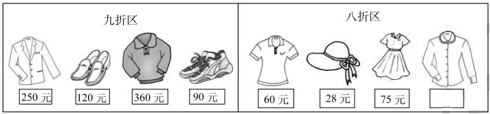

# Mathematics (Grade 6)

**ID**: 996d89c1
**难度**: hard
**题型**: fill_in_the_blank

## 题目
假日商场。 （□中的价格均为原价）

（1）买一件运动衣和一双运动鞋共需（）元。
（2）妈妈计划用350元给爸爸买一件西服上衣和一双皮鞋，还能剩下（）元。
（3）妈妈用100元正好给自己买了一条裙子和一件衬衫，衬衫的原定价是（）元。
（4）王阿姨在八折区买了两件衣服，正好用了108元，她买的是（）和（）。

## 解答

**答案**: 405, 17, 50, T恤, 裙子

1. Step1:计算买一件运动衣和一双运动鞋的原价总和，360 + 90 = 450元，再计算打九折后的价格，450×90% = 405元，得出（1）的答案为405元
2. Step2:计算买一件西服上衣和一双皮鞋的原价总和，350 + 120 = 470元，打九折后的价格为470×90% = 423元，用440元减去打折后的价格440 - 423 = 17元，得出（2）的答案为17元
3. Step3:先计算裙子打八折后的价格，75×80% = 60元，用100元减去裙子打折后的价格得到衬衫打折后的价格100 - 60 = 40元，再计算衬衫的原价，40÷80% = 50元，得出（3）的答案为50元
4. Step4:先计算两件衣服的原价总和，108÷80% = 135元，八折区中60 + 75 = 135元，得出（4）买的是T恤和裙子

## 知识点

**知识点**:
  - 整数、分数、小数、百分数四则混合运算;分数的除法;折扣问题

---
