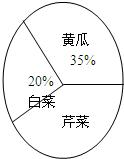

# Mathematics (Grade 6)

**ID**: 9a3180d0
**难度**: hard
**题型**: fill_in_the_blank

## 题目
为抵御2010年的通货膨胀，某市鼓励种植蔬菜，小红家的一块6000平方米的菜地，种植了3种蔬菜，分布情况如图：
①芹菜占总面积的$\underline{\hspace{5em}}$%．
②白菜种植面积是$\underline{\hspace{5em}}$平方米．
③每平方米收黄瓜12千克，今年共收黄瓜多少千克？

## 解答

**答案**: 45, 1200, 25200

1. Step1:计算芹菜占总面积的百分比，用1减去白菜占总面积的20%与黄瓜占总面积的35%，即1-(20% + 35%) = 45%
2. Step2:计算白菜种植面积，用菜地总面积6000平方米乘以白菜占总面积的20%，即6000×20% = 1200平方米
3. Step3:计算黄瓜的种植面积，用菜地总面积6000平方米乘以黄瓜占总面积的35%，得到6000×35% = 2100平方米，再乘以每平方米收黄瓜的重量12千克，即2100×12 = 25200千克

## 知识点

**知识点**:
  - 扇形统计图；统计图表的综合分析、解释和应用．

---
