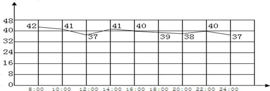

# Mathematics (Grade 6)

**ID**: 9a696dcd
**难度**: hard
**题型**: fill_in_the_blank

## 题目
下面是张大爷生病住院一段时间体温变化情况统计表

（1）张大爷每隔$\underline{\hspace{5em}}$小时量一次体温．
（2）张大爷体温下降最快的是$\underline{\hspace{5em}}$时到$\underline{\hspace{5em}}$时，体温上升最快的是$\underline{\hspace{5em}}$时到$\underline{\hspace{5em}}$时．
（3）你还能提出什么问题，并解答．

## 解答

**答案**: 2, 10, 12, 12, 14, 张大爷的最高体温是多少，最低体温是多少，相差几度？, 最高体温为42°，最低体温为37°，相差42°-37°=5°

1. Step1:观察统计图中量体温的时间点8时、10时、12时等，计算相邻时间点差值，10 - 8 = 2，12 - 10 = 2，得出张大爷每隔2小时量一次体温
2. Step2:观察统计图中体温变化折线，比较各时间段体温下降幅度，发现10时到12时体温下降幅度最大，得出张大爷体温下降最快的是10时到12时
3. Step3:观察统计图中体温变化折线，比较各时间段体温上升幅度，发现12时到14时体温上升幅度最大，得出张大爷体温上升最快的是12时到14时
4. Step4:提出问题“张大爷的最高体温是多少，最低体温是多少，相差几度？”
5. Step5:从统计图中找出最高体温为42°，最低体温为37°
6. Step6:计算最高体温与最低体温的差值42 - 37 = 5°，得出相差5°

## 知识点

**知识点**:
  - 单式折线统计图；从统计图表中获取信息．

---
