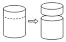

# Mathematics (Grade 6)

**ID**: 9b7f9d5d
**难度**: hard
**题型**: fill_in_the_blank

## 题目
有一个圆柱体，高是底面半径的3倍，将它如图分成大、小两个圆柱体，大圆柱体的表面积是小圆柱体的表面积的3倍，那么大圆柱体的体积是小圆柱体的体积的（________）倍。

## 解答

**答案**: 11

1. Step1:设圆柱体底面半径为r，那么高为3r，设小圆柱体高为h，则大圆柱体高为(3r - h)
2. Step2:根据大圆柱体的表面积是小圆柱体的表面积的3倍这一关系，求出h = $\frac{1}{	ext{4}}r$
3. Step3:计算大圆柱的高为3r - $\frac{1}{	ext{4}}r$ = $\frac{11}{	ext{4}}r$
4. Step4:因为两圆柱体底面积相同，计算大圆柱的高是小圆柱高的$\frac{11}{	ext{4}}r$÷$\frac{1}{	ext{4}}r$ = 11
5. Step5:由于大小圆柱的底面积相同，得出高的比就是体积的比，所以大圆柱的体积是小圆柱体积的11倍

## 知识点

**知识点**:
  - 

---
