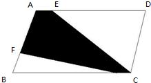

# Mathematics (Grade 6)

**ID**: 9ce4d61b
**难度**: hard
**题型**: fill_in_the_blank

## 题目
在平行四边形ABCD中，AE与ED的比是1：2，BF是FA的$\frac{1}{3}$，则阴影部分的面积是平行四边形面积的$\underline{\hspace{5em}}$．

## 解答

**答案**: $\frac{13}{24}$

1. Step1:由BF是FA的$\frac{1}{3}$，得出BF：FA=1：3，进而得到BF：BA=1：4
2. Step2:根据BF：BA=1：4，推出三角形BCF的高是平行四边形的高的$\frac{1}{4}$
3. Step3:由三角形面积公式，算出三角形BCF的面积是平行四边形面积的$\frac{1}{4}$×$\frac{1}{2}$=$\frac{1}{8}$
4. Step4:由AE与ED的比是1：2，得出DE：AE=2：1，进而得到DE：AD=2：3
5. Step5:根据DE：AD=2：3，推出三角形CDE的底是平行四边形的底的$\frac{2}{3}$
6. Step6:由三角形面积公式，算出三角形CDE的面积是平行四边形面积的$\frac{2}{3}×\frac{1}{2}=\frac{1}{3}$
7. Step7:用1减去三角形BCF与三角形CDE占平行四边形面积的分率，即1 - $\frac{1}{8} - \frac{1}{3} = \frac{13}{24}$，得到阴影部分面积是平行四边形面积的$\frac{13}{24}$

## 知识点

**知识点**:
  - 组合图形的面积．

---
