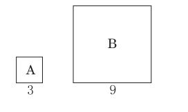

# Mathematics (Grade 6)

**ID**: 9dc88a71
**难度**: hard
**题型**: fill_in_the_blank

## 题目
按要求做一做。
（1）图中A，B两个正方形边长之比是（），周长之比是（），这两个比能组成比例吗？

（2）如图中A，B两个正方形面积的比是（），它与边长的比能组成比例吗？

## 解答

**答案**: 3:9, 12:36, 能, 9:81, 不能

1. Step1:根据图中信息，A正方形边长为3，B正方形边长为9，所以边长之比为3:9
2. Step2:根据正方形周长公式C = 4a（C为周长，a为边长），A正方形周长为3×4 = 12，B正方形周长为9×4 = 36，所以周长之比为12:36
3. Step3:计算边长比3:9的比值为3÷9 = 1/3，周长比12:36的比值为12÷36 = 1/3，因为1/3 = 1/3，所以边长比和周长比能组成比例
4. Step4:根据正方形面积公式S = a²（S为面积，a为边长），A正方形面积为3×3 = 9，B正方形面积为9×9 = 81，所以面积之比为9:81
5. Step5:计算边长比3:9的比值为1/3，面积比9:81的比值为9÷81 = 1/9，因为1/3 ≠ 1/9，所以面积比与边长比不能组成比例

## 知识点

**知识点**:
  - 比例的意义和基本性质

---
