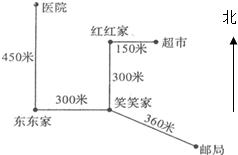

# Mathematics (Grade 6)

**ID**: a2f4d4b0
**难度**: hard
**题型**: fill_in_the_blank

## 题目
（1）笑笑家的北面是 $\underline{\hspace{5em}}$ ，超市在东东家的 $\underline{\hspace{5em}}$ 面．
（2）东东从家出发先向 $\underline{\hspace{5em}}$ 走 $\underline{\hspace{5em}}$ 米到笑笑家，再向 $\underline{\hspace{5em}}$ 走 $\underline{\hspace{5em}}$ 米就到邮局了．
（3）三个人中， $\underline{\hspace{5em}}$ 家距医院最远，是 $\underline{\hspace{5em}}$ 米．

## 解答

**答案**: 红红家, 东北, 东, 300, 东南, 360, 红红, 1050

1. Step1:根据地图方向辨别方法'上北下南，左西右东'，观察笑笑家的北面，得出笑笑家的北面是红红家
2. Step2:同样依据'上北下南，左西右东'，判断超市相对于东东家的方向，可知超市在东东家的东北面
3. Step3:看东东从家到笑笑家的路线，得出东东从家出发先向东走300米到笑笑家
4. Step4:再看笑笑家到邮局的路线，可知从笑笑家再向东南走360米就到邮局了
5. Step5:分别计算东东家、红红家、笑笑家到医院的距离，东东家到医院距离为300 + 450 = 750米，红红家到医院距离为300 + 300 + 450 = 1050米，笑笑家到医院距离为300 + 450 = 750米
6. Step6:比较三家到医院的距离，750米 < 1050米，得出三个人中，红红家距医院最远，是1050米

## 知识点

**知识点**:
  - 路线图;方向

---
