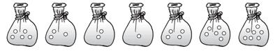

# Mathematics (Grade 6)

**ID**: a31aa906
**难度**: hard
**题型**: fill_in_the_blank

## 题目

1.一共有（）袋球。（yí gòng yǒu  dài qiú。）
2.从左数，第（）袋球最多，是（）个，第（）袋球最少，是（）个。（cóng zuǒ shǔ，dì（）dài qiú zuì duō，shì（）gè，dì（）dài qiú zuì shǎo shì（）gè。）
3.从右数，第1袋和第（）袋合起来是9个球，第（）袋和第（）袋合起来也是9个球，第（）袋和第（）袋合起来也是9个球。（cóng yòu shǔ，dì 1 dài hé dì（）dài hé qǐ lái shì 9 gè qiú，dì（）dài hé dì（）dài hé qǐ lái yě shì 9 gè qiú，dì（）dài hé dì（）dài hé qǐ lái yě shì 9 gè qiú。）

## 解答

**答案**: 7, 7, 7, 4, 1, 5, 2, 6, 3, 7

1. Step1:按照顺序数出图中球的袋数，可得一共有7袋球
2. Step2:依次数出图中每个袋子中球的个数，分别为：第1袋3个、第2袋2个、第3袋3个、第4袋1个、第5袋2个、第6袋4个、第7袋7个，比较后可知从左数第7袋球最多，是7个，第4袋球最少，是1个
3. Step3:从右数，第1袋有7个球，9 - 7 = 2，从右数第5袋有2个球，所以从右数第1袋和第5袋合起来是9个球
4. Step4:继续观察，第2袋有4个球，第6袋有5个球，4 + 5 = 9，所以从右数第2袋和第6袋合起来是9个球
5. Step5:再看，第3袋有3个球，第7袋有6个球，3 + 6 = 9，所以从右数第3袋和第7袋合起来是9个球
6. Step6:将上述结果整理成答案列表，即['7', '7', '7', '4', '1', '5', '2', '6', '3', '7']

## 知识点

**知识点**:
  - 10以内数的加减法;10以内数的认识;位置与顺序

---
