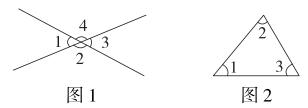

# Mathematics (Grade 6)

**ID**: a7c5398d
**难度**: hard
**题型**: fill_in_the_blank

## 题目
先估一估，再量一量各个角的度数。

（1）我量得图1中∠1=（），∠2=（），∠3=（），∠4=（）。我发现：两条直线相交成四个角，相邻两个角的度数和是（）度，相对两个角的度数（）。
（2）我量得图2中∠1=（），∠2=（），∠3=（）。
我发现：三角形三个角的度数和是（）度。

## 解答

**答案**: 50°, 130°, 50°, 130°, 180, 相等, 50°, 70°, 60°, 180

1. Step1:使用量角器量图1中∠1，得到∠1 = 50°
2. Step2:使用量角器量图1中∠2，得到∠2 = 130°
3. Step3:使用量角器量图1中∠3，得到∠3 = 50°
4. Step4:使用量角器量图1中∠4，得到∠4 = 130°
5. Step5:计算图1中相邻两角的度数和，如∠1 + ∠2 = 50° + 130° = 180°，得出相邻两个角的度数和是180度
6. Step6:比较图1中相对两角的度数，如∠1 = ∠3 = 50°，得出相对两个角的度数相等
7. Step7:使用量角器量图2中∠1，得到∠1 = 50°
8. Step8:使用量角器量图2中∠2，得到∠2 = 70°
9. Step9:使用量角器量图2中∠3，得到∠3 = 60°
10. Step10:计算图2中三个角的度数和，即∠1 + ∠2 + ∠3 = 50° + 70° + 60° = 180°，得出三角形三个角的度数和是180度

## 知识点

**知识点**:
  - 角的度量

---
