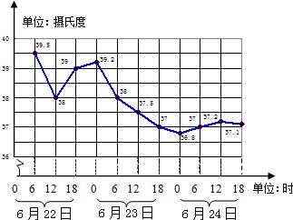

# Mathematics (Grade 6)

**ID**: aa3ced85
**难度**: hard
**题型**: fill_in_the_blank

## 题目
下面是一位甲型H1N1流感病人三天的体温记录统计图．
①护士每隔$\underline{\hspace{5em}}$小时给病人量一次体温．
②这个病人的体温最高是$\underline{\hspace{5em}}$摄氏度．
③病人在6月23日0时的体温是$\underline{\hspace{5em}}$摄氏度．
④病人的体温在$\underline{\hspace{5em}}$那天里比较平稳．
⑤从体温看，病人的病情是恶化还是好转？

## 解答

**答案**: 6, 39.5, 39.2, 6月24日, 好转

1. Step1:观察统计图中测量体温的时间点，发现每天测量体温的时间分别是0时，6时，12时，18时，所以得出护士每隔6小时给病人量一次体温
2. Step2:观察统计图中折线的最高点对应的体温数值，可得这个病人的最高体温是39.5摄氏度
3. Step3:在统计图中找到6月23日0时对应的体温刻度，可知病人在6月23日0时的体温是39.2摄氏度
4. Step4:观察统计图中折线的起伏情况，发现6月24日折线变化最平缓，所以这个病人的体温在6月24日里比较平稳
5. Step5:根据人体正常体温是37℃，观察病人后来的体温稳定在接近37℃的水平线上，得出从体温看，病人的病情是好转

## 知识点

**知识点**:
  - 统计图表的综合分析、解释和应用．

---
