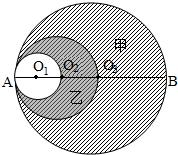

# Mathematics (Grade 6)

**ID**: acb60e6e
**难度**: hard
**题型**: fill_in_the_blank

## 题目
如图，AO$_{3}$=$\frac{1}{2}$AB，AO$_{2}$=$\frac{1}{2}$AO$_{3}$，阴影甲与阴影乙的面积的比$\underline{\hspace{5em}}$．

## 解答

**答案**: 4：1

1. Step1:设圆O$_{1}$的半径为r
2. Step2:由AO$_{2}$=$rac{1}{2}$AO$_{3}$，AO$_{3}$=$rac{1}{2}$AB，可得圆O$_{2}$的半径为2r，圆O$_{3}$的半径为4r
3. Step3:根据圆的面积公式S = πr$^{2}$，计算阴影甲的面积为π（4r）$^{2}$ - π（2r）$^{2}$ = 16πr$^{2}$ - 4πr$^{2}$ = 12πr$^{2}$
4. Step4:根据圆的面积公式S = πr$^{2}$，计算阴影乙的面积为π（2r）$^{2}$ - πr$^{2}$ = 4πr$^{2}$ - πr$^{2}$ = 3πr$^{2}$
5. Step5:求阴影甲与阴影乙的面积之比为12πr$^{2}$：3πr$^{2}$ = 4：1

## 知识点

**知识点**:
  - 组合图形的面积；比的意义．

---
