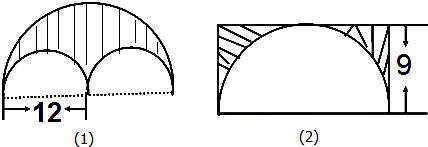

# Mathematics (Grade 6)

**ID**: ad88e069
**难度**: hard
**题型**: fill_in_the_blank

## 题目
求阴影部分的面积．（单位：厘米）

（1）$\underline{\hspace{5em}}$；（2）$\underline{\hspace{5em}}$．

## 解答

**答案**: 113.04平方厘米, 34.83平方厘米

1. Step1:分析图（1），根据解析2可知，阴影部分面积是半径为12厘米半圆的面积减去直径为12厘米圆的面积，先计算半径为12厘米半圆的面积，根据圆的面积公式S = πr²，半圆面积为$rac{1}{2}$×3.14×12² = 226.08平方厘米
2. Step2:计算直径为12厘米圆的面积，其半径为$rac{12}{2}$ = 6厘米，面积为3.14×6² = 113.04平方厘米
3. Step3:用半径为12厘米半圆的面积减去直径为12厘米圆的面积，得到图（1）阴影部分面积为226.08 - 113.04 = 113.04平方厘米
4. Step4:分析图（2），根据解析2可知，阴影部分面积是长为9×2 = 18厘米，宽为9厘米的长方形的面积减去半径为9厘米的半圆的面积，先计算长方形面积为18×9 = 162平方厘米
5. Step5:计算半径为9厘米的半圆的面积，为$rac{1}{2}$×3.14×9² = 127.17平方厘米
6. Step6:用长方形面积减去半径为9厘米的半圆的面积，得到图（2）阴影部分面积为162 - 127.17 = 34.83平方厘米

## 知识点

**知识点**:
  - 组合图形的面积．

---
