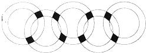

# Mathematics (Grade 6)

**ID**: af3f7a4d
**难度**: hard
**题型**: fill_in_the_blank

## 题目
奥运会的会徽是五环图，一个五环图是由内圆直径为6厘米，外圆直径为8厘米的五环组成，其中两两相交的小曲边四边形（阴影部分）的面积都相等，已知五个圆环盖住的面积是77.1平方厘米．每个小曲边四边形的面积是$\underline{\hspace{5em}}$．

## 解答

**答案**: 4.1

1. Step1:计算一个圆环的内半径，6÷2 = 3厘米
2. Step2:计算一个圆环的外半径，8÷2 = 4厘米
3. Step3:根据圆环面积公式π（大圆半径的平方 - 小圆半径的平方），计算一个圆环的面积，3.14×(4² - 3²)=3.14×7 = 21.98平方厘米
4. Step4:计算5个圆环的面积，21.98×5 = 109.9平方厘米
5. Step5:根据五个圆环盖住的面积 = 5个圆环的面积之和 - 8个小曲边四边形面积，可知8个小曲边四边形面积为5个圆环的面积之和 - 五个圆环盖住的面积，即109.9 - 77.1 = 32.8平方厘米
6. Step6:计算一个小曲边四边形的面积，32.8÷8 = 4.1平方厘米

## 知识点

**知识点**:
  - 圆与组合图形．

---
