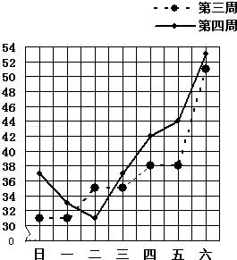

# Mathematics (Grade 6)

**ID**: b07b8d28
**难度**: hard
**题型**: fill_in_the_blank

## 题目
如图是某地旅游黄金月第三周和第四周游客统计图．看图分析并填空．
（1）第$\underline{\hspace{5em}}$周游客总量较大．
（2）游客最多的一天是第$\underline{\hspace{5em}}$周星期$\underline{\hspace{5em}}$．
（3）与头一天比，第$\underline{\hspace{5em}}$周星期$\underline{\hspace{5em}}$的游客人数增长幅度最大．
（4）一周内游客流量总趋势是$\underline{\hspace{5em}}$．

## 解答

**答案**: 4, 4, 六, 3, 六, 上升

1. Step1:观察统计图中第三周和第四周的折线，发现第四周的折线上升更快，所以得出第四周游客总量较大，对应答案第一个值为'4'
2. Step2:观察统计图，找到折线的最高点，发现是第四周的星期六，所以游客最多的一天是第4周星期六，对应答案第二个值为'4'，第三个值为'六'
3. Step3:对比第三周和第四周周五与周六游客人数的差，发现第三周周六与周五游客人数的增长幅度最大，所以与头一天比，第3周星期六的游客人数增长幅度最大，对应答案第四个值为'3'，第五个值为'六'
4. Step4:观察统计图中折线的整体走向，发现折线一直呈上升趋势，所以一周内游客流量总趋势是上升，对应答案第六个值为'上升'

## 知识点

**知识点**:
  - 物体的比较、排列和分类．

---
