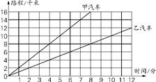

# Mathematics (Grade 6)

**ID**: b0844316
**难度**: hard
**题型**: fill_in_the_blank

## 题目
（1）判断下列说法是否正确（对的画“√”，错的画“×”）
①甲、乙两车是同时出发的．$\underline{\hspace{5em}}$

②甲和乙行驶的路程相同．$\underline{\hspace{5em}}$
③甲车比乙车速度快．$\underline{\hspace{5em}}$
（2）从图中可以看出，随着时间的增加，距离有什么变化？

## 解答

**答案**: √, ×, √, 随着时间的增加，距离越来越大，即速度一定，路程和时间成正比例．

1. Step1:观察图像，发现甲、乙两车出发时间对应的横坐标相同，所以甲、乙两车是同时出发的，故①说法正确，答案为√
2. Step2:观察图像，甲汽车行驶到16千米处时，乙汽车行驶到12千米处，甲行驶的路程比乙多，所以甲和乙行驶的路程相同这一说法错误，答案为×
3. Step3:根据速度=路程÷时间，在相同时间内，甲行驶的路程比乙多，所以甲车比乙车速度快，说法正确，答案为√
4. Step4:观察图像，发现随着时间的增加，甲、乙两车对应的路程数值也在增大，所以从图中可以看出，随着时间的增加，距离越来越大，即速度一定，路程和时间成正比例，得出（2）的答案为随着时间的增加，距离越来越大，即速度一定，路程和时间成正比例．

## 知识点

**知识点**:
  - 正比例和反比例的意义．

---
