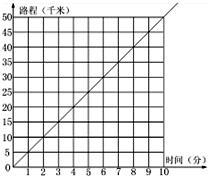

# Mathematics (Grade 6)

**ID**: b0e10463
**难度**: hard
**题型**: fill_in_the_blank

## 题目

(2012•岳池县模拟)下面是一列动车行驶情况的统计图．
(1)这列动车每小时行驶______千米．这列动车行驶的路程和时间成______比例．
(2)按这样的速度，从广州到武汉大约1000千米路程，要行驶______小时．(得数保留整数)

## 解答

**答案**: 300, 正, 3

1. Step1:从统计图可知10分钟动车行驶了50千米，将10分钟换算为小时，10分钟 = 10÷60 = $rac{1}{6}$小时
2. Step2:根据速度 = 路程÷时间，计算动车速度，即50÷$rac{1}{6}$ = 300千米/小时
3. Step3:因为速度一定时，路程和时间的比值一定，所以这列动车行驶的路程和时间成正比例
4. Step4:已知路程为1000千米，速度为300千米/小时，根据时间 = 路程÷速度，计算从广州到武汉所需时间，1000÷300≈3小时

## 知识点

**知识点**:
  - 复式折线统计图;简单的行程问题;辨识成正比例的量与成反比例的量;从统计图表中获取信息．

---
