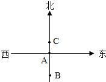

# Mathematics (Grade 6)

**ID**: b11babc4
**难度**: hard
**题型**: fill_in_the_blank

## 题目
海滨市有一东西走向的路与另一南北走向的路交汇于路口A．李智聪在路口A南面240来的B点处．陈晓慧在路口A北面120米的C点处．李以每分钟80米的速度匀速行走，陈以每分钟60米的速度匀速行走，两人都是先朝着A点走去，到达A后立即转向往东面继续走．他俩在某一点D第一次相遇，D点距A点$\underline{\hspace{5em}}$米．

## 解答

**答案**: 240

1. Step1:计算李智聪到达A点所用的时间，根据公式路程÷速度=时间，可得240÷80 = 3分钟
2. Step2:计算陈晓慧到达A点所用的时间，根据公式路程÷速度=时间，可得120÷60 = 2分钟
3. Step3:比较两人到达A点的时间，可知陈晓慧比李智聪提前3 - 2 = 1分钟到达A点
4. Step4:当李智聪到达A点时，陈晓慧已经向东行驶了1分钟，根据路程=速度×时间，行驶的路程为60×1 = 60米
5. Step5:当陈晓慧从A点向东行驶2分钟时，行驶的路程为60×2 = 120米，此时李智聪行驶了1分钟，行驶的路程为80×1 = 80米
6. Step6:当陈晓慧从A点向东行驶3分钟时，行驶的路程为60×3 = 180米，此时李智聪行驶了2分钟，行驶的路程为80×2 = 160米
7. Step7:当陈晓慧从A点向东行驶4分钟时，行驶的路程为60×4 = 240米，此时李智聪向东行驶了3分钟，行驶的路程为80×3 = 240米，两人第一次相遇，所以A点到D点的距离为240米

## 知识点

**知识点**:
  - 根据方向和距离确定物体的位置．

---
