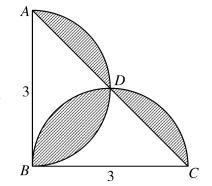

# Mathematics (Grade 6)

**ID**: b6fd4ec9
**难度**: hard
**题型**: fill_in_the_blank

## 题目
求下图中阴影部分的面积（长度单位：厘米）
 $\underline{\hspace{5em}}$ 平方厘米。

## 解答

**答案**: 2.565

1. Step1:计算半圆的半径，3÷2=1.5厘米
2. Step2:计算直径为3厘米半圆的面积，3.14×1.5×1.5÷2=3.5325平方厘米
3. Step3:计算底是3厘米，高是1.5厘米三角形的面积，3×1.5÷2=2.25平方厘米
4. Step4:计算直径为3厘米半圆的面积减去底是3厘米，高是1.5厘米三角形的面积，3.5325 - 2.25 = 1.2825平方厘米，此为阴影部分面积的一半
5. Step5:计算阴影部分的面积，1.2825×2=2.565平方厘米

## 知识点

**知识点**:
  - 与圆有关的组合图形求面积

---
