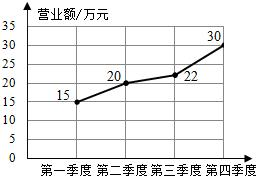

# Mathematics (Grade 6)

**ID**: b7bd61d9
**难度**: hard
**题型**: fill_in_the_blank

## 题目
某超市2005年各季度营业额如图．
(1)2005年一年的总营业额是______万元，平均每季度的营业额是______万元．
(2)第四季度的营业额比第一季度的营业额增长了______万元．
(3)你认为这家超市的前景______，因为______．

## 解答

**答案**: 88, 22, 15, 十分美好, 营业额总是呈上升趋势

1. Step1:观察统计图得出第一季度营业额为15万元，第二季度营业额为20万元，第三季度营业额为22万元，第四季度营业额为30万元
2. Step2:计算2005年一年的总营业额，15 + 20 + 22 + 30 = 88万元
3. Step3:计算平均每季度的营业额，88÷4 = 22万元
4. Step4:计算第四季度的营业额比第一季度的营业额增长的金额，30 - 15 = 15万元
5. Step5:观察统计图，发现营业额总是呈上升趋势，得出这家超市前景十分美好

## 知识点

**知识点**:
  - 单式折线统计图;从统计图表中获取信息．

---
