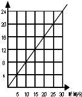

# Mathematics (Grade 6)

**ID**: b7df30c7
**难度**: hard
**题型**: fill_in_the_blank

## 题目
如图是长颈鹿奔跑的路程和时间的对应图．
（1）根据图象可判断出长颈鹿奔跑路程和时间成$\underline{\hspace{5em}}$关系．
（2）依据图象可知，20分钟时，长颈鹿奔跑的路程是$\underline{\hspace{5em}}$．
（3）长颈鹿奔跑20千米所需时间为$\underline{\hspace{5em}}$．
（4）长颈鹿的奔跑速度为平均每分钟$\underline{\hspace{5em}}$千米．

## 解答

**答案**: 正比例, 16千米, 25分钟, 0.8千米/分钟

1. Step1:观察图象，发现长颈鹿奔跑速度一定，也就是路程和时间的比值一定，所以判断出路程和时间成正比例关系
2. Step2:从图象中读取，当时间为20分钟时，对应的路程是16千米
3. Step3:从图象中找到路程为20千米时，对应的时间是25分钟
4. Step4:根据公式路程÷时间=速度，选取图象上一点（如5分钟跑了4千米），计算4÷5 = 0.8，得出长颈鹿平均每分钟跑0.8千米

## 知识点

**知识点**:
  - 单式折线统计图；从统计图表中获取信息．

---
