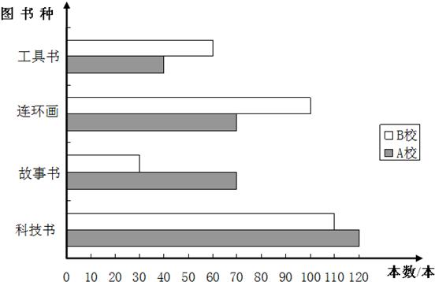

# Mathematics (Grade 6)

**ID**: b997fbaa
**难度**: hard
**题型**: fill_in_the_blank

## 题目
下面是两个学校从新华书店购买图书情况的统计图
． 

（1）填空．
①每个小格表示(    )本．
②A校共买书(    )本；B校共买书(    )本．
（2）请你根据统计图，再提出两个问题，并解答出来．
问题1：(    )？(    )
问题2：(    )？(    )
（3）完成下表．
$\begin{array}{|c|c|c|c|c|}
\hline
图书种类数量/本学校 & 工具书 & 连环画 & 故事书 & 科技书 \\ \hline
A校 &  &  &  &  \\ \hline
B校 &  &  &  &  \\ \hline
\end{array}$

## 解答

**答案**: 10, 300, 300, A校的科技书比B校的科技书多多少本？, 10（本）, AB两校的故事书共有多少本？, 100（本）, 60, 100, 30, 110, 40, 70, 70, 120

1. Step1:观察统计图的横轴刻度，相邻两个刻度差值为10，得出每个小格表示10本
2. Step2:计算A校买书总数，A校工具书40本、连环画70本、故事书70本、科技书120本，40 + 70 + 70 + 120 = 300本
3. Step3:计算B校买书总数，B校工具书60本、连环画100本、故事书30本、科技书110本，60 + 100 + 30 + 110 = 300本
4. Step4:提出问题1为A校的科技书比B校的科技书多多少本，计算120 - 110 = 10本
5. Step5:提出问题2为AB两校的故事书共有多少本，计算70 + 30 = 100本
6. Step6:根据统计图，A校工具书数量为40本，填入对应表格
7. Step7:根据统计图，A校连环画数量为70本，填入对应表格
8. Step8:根据统计图，A校故事书数量为70本，填入对应表格
9. Step9:根据统计图，A校科技书数量为120本，填入对应表格
10. Step10:根据统计图，B校工具书数量为60本，填入对应表格
11. Step11:根据统计图，B校连环画数量为100本，填入对应表格
12. Step12:根据统计图，B校故事书数量为30本，填入对应表格
13. Step13:根据统计图，B校科技书数量为110本，填入对应表格

## 知识点

**知识点**:
  - 两种不同形式的复式条形统计图；“提问题”、“填条件”应用题；从统计图表中获取信息；统计图表的填补．

---
