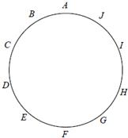

# Mathematics (Grade 6)

**ID**: bc1f066d
**难度**: hard
**题型**: fill_in_the_blank

## 题目
如图所示，有10个人面向一张圆桌围坐在一起，其中每个人都或者是糊涂神，或者是精灵．对在座的每个人都提问：“你右边的邻座是糊涂神还是精灵？”精灵总是给出正确的答案，而糊涂神则既可能回答正确，也可能回答得不正确．
（1）如果10个人中只有A和B回答：“我右边的邻座是糊涂神．”其他人均回答：“我右边的邻座是精灵．”且已知10个人中只有1个糊涂神，那么可以确定$\underline{\hspace{5em}}$是糊涂神．（填对应字母）
（2）如果10个人中只有A、D和G回答：“我右边的邻座是糊涂神．”其他人均回答：“我右边的邻座是精灵．”且已知10个人中只有4个糊涂神．根据以上信息，我们只能确定10人中的2个一定是精灵，他们是$\underline{\hspace{5em}}$．（填对应字母）

## 解答

**答案**: B, A和J

1. Step1:对于第一问，已知只有1个糊涂神，且A和B都说“我右边的邻座是糊涂神”，所以A和B中必有一个是糊涂神。
2. Step2:假设A是糊涂神，那么J是精灵，按照精灵会给出正确答案，J会说“我右边的邻座是糊涂神”，但实际只有A和B这么说，所以A不是糊涂神，那么B一定是糊涂神。
3. Step3:对于第二问，因为只有A、D和G说“我右边的邻座是糊涂神”，所以A和B、D和E、G和H三组中每组至少有一个糊涂神，进而推出除这三组外的四人（J、I、C、F）中至多有一个糊涂神。
4. Step4:假设J是糊涂神，那么I和H也会是糊涂神，这与J和I中至多有一个糊涂神矛盾，所以J不是糊涂神。
5. Step5:假设A是糊涂神，那么J就是糊涂神，这与J不是糊涂神矛盾，所以A也不是糊涂神，从而确定A和J一定是精灵。

## 知识点

**知识点**:
  - 逻辑推理．

---
