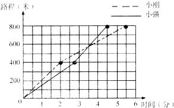

# Mathematics (Grade 6)

**ID**: bc949661
**难度**: hard
**题型**: fill_in_the_blank

## 题目
小刚和小强爬山比赛情况如图：
（1）开赛$\underline{\hspace{5em}}$分的时候，$\underline{\hspace{5em}}$追赶上$\underline{\hspace{5em}}$；$\underline{\hspace{5em}}$先到达终点．
（2）小刚平均每分行多少米？（得数保留整数）

## 解答

**答案**: 3.5, 小强, 小刚, 小强, 145

1. Step1:观察统计图，明确实线代表小强，虚线代表小刚
2. Step2:查看统计图，找到实线和虚线重合的点对应的时间为3.5分，此时小强追赶上小刚
3. Step3:观察统计图，看到小强先到达800米终点
4. Step4:由图可知比赛路程为800米，小刚到达终点用时5.5分
5. Step5:根据路程÷时间=速度，计算800÷5.5并保留整数得到145

## 知识点

**知识点**:
  - 复式折线统计图；从统计图表中获取信息．

---
