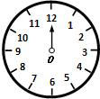

# Mathematics (Grade 6)

**ID**: bf47bf5e
**难度**: hard
**题型**: fill_in_the_blank

## 题目
如图：
(1)指针从“12”绕点O顺时针旋转90°到______．
(2)指针从“12”绕点O逆时针旋转60°到______．
(3)指针从“1”绕点O顺时针旋转______到“3”．
(4)指针从“6”绕点O顺时针旋转180°到______．
(5)指针从“3”绕点O顺时针旋转______到“4”．

## 解答

**答案**: 3, 10, 60°, 12, 30°

1. Step1:根据钟面知识，钟面上12个数字把钟面平均分成12份，每份所对应的圆周角是360°÷12 = 30°，即每两个相邻数字间的夹角是30°。
2. Step2:对于(1)，指针从“12”绕点O顺时针旋转90°，90°÷30° = 3，即旋转了3个间隔，所以到3。
3. Step3:对于(2)，指针从“12”绕点O逆时针旋转60°，60°÷30° = 2，即旋转了2个间隔，所以到10。
4. Step4:对于(3)，指针从“1”绕点O顺时针旋转到“3”，经过了2个间隔，2×30° = 60°，所以旋转了60°。
5. Step5:对于(4)，指针从“6”绕点O顺时针旋转180°，180°÷30° = 6，即旋转了6个间隔，所以到12。
6. Step6:对于(5)，指针从“3”绕点O顺时针旋转到“4”，经过了1个间隔，所以旋转了30°。
7. Step7:综上，答案依次为3，10，60°，12，30°，整理成列表为['3', '10', '60°', '12', '30°']

## 知识点

**知识点**:
  - 将简单图形平移或旋转一定的度数．

---
