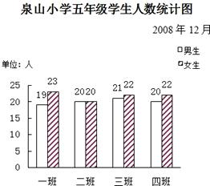

# Mathematics (Grade 6)

**ID**: c07ddac9
**难度**: hard
**题型**: fill_in_the_blank

## 题目
（1）五年级四个班中，$\underline{\hspace{5em}}$班的女生最多，$\underline{\hspace{5em}}$班的男生最少．
（2）$\underline{\hspace{5em}}$班的男、女生人数同样多．$\underline{\hspace{5em}}$班和$\underline{\hspace{5em}}$班的男生人数同样多．
（3）你还能提出什么问题？

## 解答

**答案**: 一, 一, 二, 二, 四

1. Step1:根据解析2可知，一班女生23人，二班女生20人，三班女生22人，四班女生22人，比较可得20＜22＜23，所以一班女生最多
2. Step2:根据解析2可知，一班男生19人，二班男生20人，三班男生21人，四班男生20人，比较可得19＜20＜21，所以一班男生最少
3. Step3:根据解析2可知，二班男生20人，女生20人，所以二班男、女生人数同样多
4. Step4:根据解析2可知，二班男生20人，四班男生20人，所以二班和四班的男生人数同样多

## 知识点

**知识点**:
  - 从统计图表中获取信息．

---
