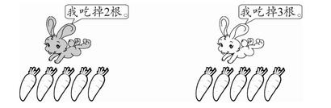

# Mathematics (Grade 6)

**ID**: c0b7a144
**难度**: hard
**题型**: fill_in_the_blank

## 题目
小白兔和小灰兔分到同样的萝卜，谁剩的萝卜多？列式计算。

               □○□=□（根）                                  □○□=□（根）
□＞□    （）剩的萝卜多。

## 解答

**答案**: 5-2=3, 5-3=2, 3＞2, 小白兔

1. Step1:已知小白兔有5根萝卜，吃掉2根，根据减法意义，用5 - 2计算小白兔剩下萝卜数量
2. Step2:计算5 - 2的结果为3，即小白兔剩下3根萝卜
3. Step3:已知小灰兔有5根萝卜，吃掉3根，根据减法意义，用5 - 3计算小灰兔剩下萝卜数量
4. Step4:计算5 - 3的结果为2，即小灰兔剩下2根萝卜
5. Step5:比较3和2的大小，因为3＞2
6. Step6:得出小白兔剩的萝卜多

## 知识点

**知识点**:
  - 

---
