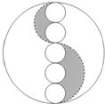

# Mathematics (Grade 6)

**ID**: c0f07124
**难度**: hard
**题型**: fill_in_the_blank

## 题目
如图所示，大圆的直径是小圆的5倍，大圆内的“S”形曲线（图中虚线）由两段半圆弧组成．如果已知阴影部分的面积等于4，那么图中空白部分的面积等于$\underline{\hspace{5em}}$．

## 解答

**答案**: 21

1. Step1:设小圆的半径为r，根据大圆的直径是小圆的5倍，可得大圆的半径为5r，同时得出小阴影部分的半径为2r，大阴影部分的半径为3r
2. Step2:计算小阴影部分的面积，根据圆的面积公式s = πr²，小阴影部分面积为π(2r)²÷2 - πr² = πr²
3. Step3:计算大阴影部分的面积，大阴影部分面积为π(3r)²÷2 - 3/2πr² = 9/2πr² - 3/2πr² = 3πr²
4. Step4:因为阴影部分面积等于4，即小阴影部分面积与大阴影部分面积之和为4，所以πr² + 3πr² = 4，进一步得到4πr² = 4，从而算出πr² = 1
5. Step5:计算大圆的面积，根据圆的面积公式可得大圆面积为π(5r)² = 25πr²，将πr² = 1代入，得出大圆面积为25
6. Step6:计算空白部分的面积，用大圆的面积减去阴影部分的面积，即25 - 4 = 21

## 知识点

**知识点**:
  - 圆、圆环的面积；组合图形的面积．

---
