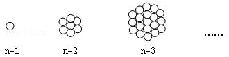

# Mathematics (Grade 6)

**ID**: c1cdc4f8
**难度**: hard
**题型**: fill_in_the_blank

## 题目
如图，当n=1时，图中有1个圆；当n=2时，图中有7个圆；当n=3时，图中有19个圆；…，按此规律，当n=5时，图中有 $\underline{\hspace{5em}}$ 个圆．

## 解答

**答案**: 61

1. Step1:根据解析2可知，第n个图形圆的个数表达式为n+（n+1）+…（2n﹣1）+（2n﹣2）+（2n﹣3）+…+n
2. Step2:将上式变形为2[n+（n+1）+（n+2）+…+（2n﹣2）]+（2n﹣1）
3. Step3:进一步变形为（n﹣1）[n+（2n﹣2）]+（2n﹣1）
4. Step4:化简得到3n²﹣3n+1
5. Step5:当n = 5时，代入表达式为3×5²﹣3×5+1
6. Step6:先计算3×5²=3×25 = 75，再计算3×5 = 15
7. Step7:计算75 - 15 + 1 = 61

## 知识点

**知识点**:
  - 

---
