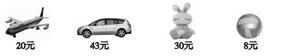

# Mathematics (Grade 6)

**ID**: c2b0863b
**难度**: hard
**题型**: fill_in_the_blank

## 题目
玩具店。

（1）买一辆玩具汽车和一架玩具飞机共花多少钱？
□○□=□（元）
（2）用10元钱买一个皮球，应找回多少钱？
□○□=□（元）
（3）王丽拿了45元钱，想买一架玩具飞机和一个可爱的玩具小兔。钱够吗？
 $\underline{\hspace{5em}}$ 
（4）你喜欢上面哪些玩具？买它们要用多少钱？
我喜欢 $\underline{\hspace{5em}}$ ，买它们需要 $\underline{\hspace{5em}}$ 。
□○□=□（元）

## 解答

**答案**: 63, 2, 不够, 一辆玩具汽车和一个可爱的玩具小兔, 73

1. Step1:计算买一辆玩具汽车和一架玩具飞机共花的钱数，43 + 20 = 63（元），得到答案63
2. Step2:计算用10元钱买一个皮球应找回的钱数，10 - 8 = 2（元），得到答案2
3. Step3:计算一架玩具飞机和一个玩具小兔的总价钱，20 + 30 = 50（元），再比较45与50大小，45 < 50，得出钱不够，得到答案不够
4. Step4:假设喜欢一辆玩具汽车和一个可爱的玩具小兔，计算其总价钱，43 + 30 = 73（元），得到答案一辆玩具汽车和一个可爱的玩具小兔、73

## 知识点

**知识点**:
  - 整数的加法和减法;整数大小的比较

---
