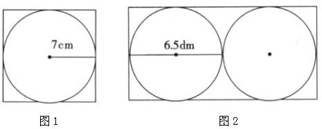

# Mathematics (Grade 6)

**ID**: c354e95f
**难度**: hard
**题型**: fill_in_the_blank

## 题目
（1）（图1）正方形的周长是$\underline{\hspace{5em}}$厘米；圆的周长是$\underline{\hspace{5em}}$厘米．
（2）（图2）长方形的周长是$\underline{\hspace{5em}}$分米；两个圆周长的和是$\underline{\hspace{5em}}$分米．

## 解答

**答案**: 56, 43.96, 39, 40.82

1. Step1:由图1可知圆是正方形内最大的圆，所以正方形边长等于圆的直径，圆半径为7厘米，直径为2×7 = 14厘米，根据正方形周长公式，正方形周长为14×4 = 56厘米
2. Step2:根据圆的周长公式，图1中圆的周长为3.14×2×7 = 43.96厘米
3. Step3:由图2可知长方形的宽等于圆的直径为6.5分米，长等于两个圆的直径为6.5×2 = 13分米
4. Step4:根据长方形周长公式，长方形周长为(6.5 + 13)×2 = 39分米
5. Step5:根据圆的周长公式，图2中一个圆的周长为3.14×6.5，两个圆周长和为3.14×6.5×2 = 40.82分米

## 知识点

**知识点**:
  - 圆、圆环的周长；长方形的周长；正方形的周长．

---
