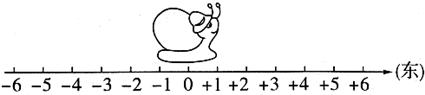

# Mathematics (Grade 6)

**ID**: c503e560
**难度**: hard
**题型**: fill_in_the_blank

## 题目
填一填．

现在蜗牛的位置在O处，每走1格表示1米．
(1)蜗牛从O点向东行2米，表示为+2米，那么从O点向西行5米，表示为______米．
(2)如果蜗牛的位置是-6米，那么它是向______行______米．如果蜗牛的位置是+5米，那么它是向______行______米．
(3)蜗牛向东行3米，又向西行6米，这时蜗牛的位置表示为______米．

## 解答

**答案**: -5, 西, 6, 东, 5, -3

1. Step1:根据正负数表示相反意义的量，向东行记为正，那么向西行记为负，所以从O点向西行5米，表示为-5米
2. Step2:因为向西行记为负，所以位置是-6米时，是向西行6米
3. Step3:由于向东行记为正，所以位置是+5米时，是向东行5米
4. Step4:蜗牛向东行3米表示为+3米，又向西行6米表示为-6米，+3 - 6 = -3米，所以这时蜗牛的位置表示为-3米

## 知识点

**知识点**:
  - 负数的意义及其应用．

---
