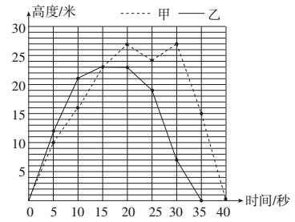

# Mathematics (Grade 6)

**ID**: c5bfbb81
**难度**: hard
**题型**: fill_in_the_blank

## 题目
下面是航模小组制作的两架航模飞机在一次飞行中飞行时间和高度的统计图。

（1）甲飞机飞行了（）秒，乙飞机飞行了（）秒，甲飞机的飞行时间比乙飞机的飞行时间长（）（填分数）。
（2）从图上看，起飞后第10秒乙飞机的高度是（）米，起飞后第（）秒两架飞机处于同一高度，起飞后第（）秒两架飞机的高度相差最大。
（3）说说从起飞后第15秒至第20秒乙飞机的飞行状态。

## 解答

**答案**: 40, 35, 1/7, 21, 15, 30, 这段时间在同一高度飞行

1. Step1:观察统计图，找到甲飞机飞行时间对应的横坐标终点为40，所以甲飞机飞行了40秒
2. Step2:观察统计图，找到乙飞机飞行时间对应的横坐标终点为35，所以乙飞机飞行了35秒
3. Step3:计算甲飞机比乙飞机飞行时间长的部分，(40 - 35)÷35 = 5÷35 = 1/7
4. Step4:从图中找到起飞后第10秒对应的乙飞机高度折线的点，其纵坐标为21，所以起飞后第10秒乙飞机的高度是21米
5. Step5:观察统计图，找到两条折线相交的点对应的横坐标为15，所以起飞后第15秒两架飞机处于同一高度
6. Step6:观察统计图，找到两条折线差距最大的点对应的横坐标约为30，所以起飞后第30秒两架飞机的高度相差最大
7. Step7:观察统计图，发现从起飞后第15秒至第20秒乙飞机的高度不变，都是23米，所以得出这段时间在同一高度飞行

## 知识点

**知识点**:
  - 复式折线统计图

---
