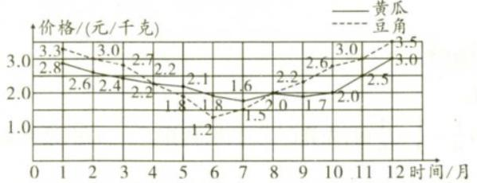

# Mathematics (Grade 6)

**ID**: c5d43fce
**难度**: hard
**题型**: fill_in_the_blank

## 题目
下面是某市一年内两种蔬菜的价格统计图。

1.从图中可以看出黄瓜的价格在（）月份最高，是（）元；豆角的价格在（）月份最高，是（）元。
2.豆角的价格是从（）月到（）月是连续下降的，（）月份价格最低，是（）元。
3.哪一种蔬菜的价格波动较小？

## 解答

**答案**: 12, 3.0, 12, 3.5, 1, 6, 6, 1.2, 黄瓜

1. Step1:观察统计图，找到黄瓜价格曲线的最高点对应的横轴月份为12月，纵轴价格为3.0元
2. Step2:观察统计图，找到豆角价格曲线的最高点对应的横轴月份为12月，纵轴价格为3.5元
3. Step3:观察豆角价格曲线，找到连续下降的区间，起始月份为1月，结束月份为6月
4. Step4:确定豆角价格曲线最低点对应的月份为6月，价格为1.2元
5. Step5:对比黄瓜和豆角价格曲线的波动幅度，得出黄瓜价格波动较小

## 知识点

**知识点**:
  - 复式折线统计图

---
