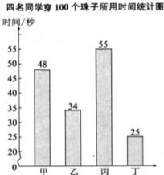

# Mathematics (Grade 6)

**ID**: c6332448
**难度**: hard
**题型**: fill_in_the_blank

## 题目
（1）起始格表示$\underline{\hspace{5em}}$秒，其他每格表示$\underline{\hspace{5em}}$秒．
（2）$\underline{\hspace{5em}}$的速度最快，$\underline{\hspace{5em}}$的速度最慢．
（3）甲、乙、丙、丁四人平均用的时间大约是$\underline{\hspace{5em}}$秒．

## 解答

**答案**: 20, 5, 丁, 丙, 40.5

1. Step1:观察统计图，确定起始格表示的时间为20秒
2. Step2:观察统计图，确定其他每格表示的时间为5秒
3. Step3:比较四人所用时间48、34、55、25的大小，得出55＞48＞34＞25
4. Step4:根据用时少速度快，确定用时最少的丁速度最快
5. Step5:根据用时多速度慢，确定用时最多的丙速度最慢
6. Step6:计算四人总时间为48+34+55+25=162秒
7. Step7:根据平均时间=总时间÷4，计算平均时间为162÷4=40.5秒

## 知识点

**知识点**:
  - 以一当五（或以上）的条形统计图；平均数的含义及求平均数的方法；从统计图表中获取信息．

---
