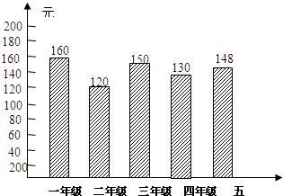

# Mathematics (Grade 6)

**ID**: c7ad7aca
**难度**: hard
**题型**: fill_in_the_blank

## 题目
如图是某校1～5年级为玉树地震捐款统计图．
（1）这是一幅$\underline{\hspace{5em}}$统计图，一个单位长度表示$\underline{\hspace{5em}}$元．．
（2）$\underline{\hspace{5em}}$年级捐款最多，是$\underline{\hspace{5em}}$元．
（3）平均每个年级捐款$\underline{\hspace{5em}}$元．
（4）二年级比一年级少捐款$\underline{\hspace{5em}}$%

## 解答

**答案**: 条形, 20, 一, 160, 141.6, 25

1. Step1:观察统计图可知这是一幅条形统计图，从纵轴刻度能看出一个单位长度表示20元
2. Step2:比较各年级柱状高度，发现一年级柱状最高，其捐款数为160元，所以一年级捐款最多
3. Step3:将一年级160元、二年级120元、三年级150元、四年级130元、五年级148元相加，即160+120+150+130+148=708元，再除以5，708÷5=141.6元，得到平均每个年级捐款141.6元
4. Step4:先计算二年级比一年级少捐的钱数，160 - 120 = 40元，再用少捐的钱数除以一年级捐款数，40÷160=0.25，化为百分数为25%，得出二年级比一年级少捐款25%

## 知识点

**知识点**:
  - 以一当五（或以上）的条形统计图；从统计图表中获取信息．

---
