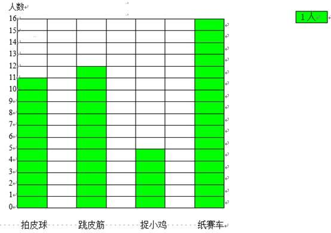

# Mathematics (Grade 6)

**ID**: c993c0e3
**难度**: hard
**题型**: fill_in_the_blank

## 题目
根据统计图信息填统计表。
二一班同学课间游戏活动统计表      2010年6月1日
$\begin{array}{|c|c|c|c|c|c|}
\hline
项\ 目
 & 拍皮球
 & 跳皮筋
 & 捉小鸡
 & 纸赛车
 & 合\ 计（一共）
 \\\hline
人\ 数
 & \underline{\hspace{5em}}
 & \underline{\hspace{5em}}
 & \underline{\hspace{5em}}
 & \underline{\hspace{5em}}
 & \underline{\hspace{5em}}
 \\\hline
\end{array}$

看了上面的统计图，你发现了什么？_______________________________________

## 解答

**答案**: 11, 12, 5, 16, 44, 我发现参加纸赛车活动的人最多，捉小鸡的最少。（答案不唯一）

1. Step1:观察统计图，可知拍皮球对应的人数高度到11的位置，所以拍皮球人数为11
2. Step2:观察统计图，跳皮筋对应的人数高度到12的位置，所以跳皮筋人数为12
3. Step3:观察统计图，捉小鸡对应的人数高度到5的位置，所以捉小鸡人数为5
4. Step4:观察统计图，纸赛车对应的人数高度到16的位置，所以纸赛车人数为16
5. Step5:计算合计人数，11 + 12 + 5 + 16 = 44，所以合计人数为44
6. Step6:通过比较各活动人数，得出参加纸赛车活动的人最多，捉小鸡的最少（答案不唯一）

## 知识点

**知识点**:
  - 小学数学;统计和概率;统计;数据的搜集与整理;统计图表的综合应用

---
