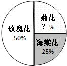

# Mathematics (Grade 6)

**ID**: cc03de9f
**难度**: hard
**题型**: fill_in_the_blank

## 题目
一个面积是200m$^{2}$的花坛里种了三种花，各种花的种植面积如图．
（1）如图是一幅 $\underline{\hspace{5em}}$ 统计图．
（2）菊花的种植面积占花坛面积的 $\underline{\hspace{5em}}$ %．
（3）玫瑰花的种植面积是 $\underline{\hspace{5em}}$ m$^{2}$．
（4）菊花与玫瑰花种植面积的比是（ $\underline{\hspace{5em}}$ ： $\underline{\hspace{5em}}$ ）．

## 解答

**答案**: 扇形, 25, 100, 1, 2

1. Step1:根据扇形统计图的意义，判断该统计图类型为扇形统计图
2. Step2:把花坛总面积看作单位“1”，即100%，用1减去玫瑰花占的50%和海棠花占的25%，得到菊花种植面积占花坛面积的1 - 50% - 25% = 25%
3. Step3:已知花坛面积是200m²，玫瑰花种植面积占50%，用200乘50%，即200×50% = 100m²，得到玫瑰花的种植面积
4. Step4:菊花种植面积占25%，玫瑰花种植面积占50%，用25%比50%，即25%：50%，化简后得到1：2

## 知识点

**知识点**:
  - 扇形统计图

---
