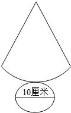

# Mathematics (Grade 6)

**ID**: cc8d02cc
**难度**: hard
**题型**: fill_in_the_blank

## 题目
认真观察物体的展开图，完成下列问题．
（1）这是一个 $\underline{\hspace{5em}}$ 体的展开图．
（2）它的底面半径是 $\underline{\hspace{5em}}$ 厘米．
（3）还原后的立体图有 $\underline{\hspace{5em}}$ 条对称轴．
（4）已知它的高是15厘米，请你计算它的体积．

## 解答

**答案**: 圆锥, 5, 1, 392.5

1. Step1:观察展开图，由圆锥展开图的特征可知这是一个圆锥体的展开图
2. Step2:已知底面直径为10厘米，根据半径 = 直径÷2，可得10÷2 = 5厘米，即底面半径是5厘米
3. Step3:依据圆锥的特征，可知还原后的圆锥体有1条对称轴
4. Step4:已知圆锥高是15厘米，底面半径是5厘米，根据圆锥体积公式v = $rac{1}{3}$sh = $rac{1}{3}×3.14×5^{2}×15$，计算可得$rac{1}{3}×3.14×25×15$ = 392.5立方厘米，即圆锥体积是392.5立方厘米

## 知识点

**知识点**:
  - 圆锥的体积;圆锥的特征

---
