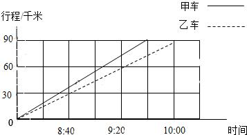

# Mathematics (Grade 6)

**ID**: cc983a79
**难度**: hard
**题型**: fill_in_the_blank

## 题目
根据甲、乙两车的行程图填空．
（1）甲车每小时行驶 $\underline{\hspace{5em}}$ Km．
（2）甲、乙两车速度的最简整数比是 $\underline{\hspace{5em}}$ ： $\underline{\hspace{5em}}$ ．
（3）甲、乙两车在8：00从同一地点出发，同向而行$\frac{2}{3}$时后，两车相距 $\underline{\hspace{5em}}$ Km．

## 解答

**答案**: 54, 6, 5, 6

1. Step1:计算甲车行驶时间，9时40分 - 8时 = 1小时40分，1小时40分换算为分数是$1\frac{2}{3}$小时
2. Step2:根据速度 = 路程÷时间，计算甲车速度，90÷$1\frac{2}{3}$ = 54千米/小时
3. Step3:计算乙车行驶时间，10时 - 8时 = 2小时
4. Step4:根据速度 = 路程÷时间，计算乙车速度，90÷2 = 45千米/小时
5. Step5:求甲、乙两车速度比，54:45，化简得到（54÷9）:（45÷9） = 6:5
6. Step6:计算甲车$\frac{2}{3}$小时行驶的路程，54×$\frac{2}{3}$ = 36千米
7. Step7:计算乙车$\frac{2}{3}$小时行驶的路程，45×$\frac{2}{3}$ = 30千米
8. Step8:计算同向而行$\frac{2}{3}$小时后两车相距的距离，36 - 30 = 6千米

## 知识点

**知识点**:
  - 复式折线统计图

---
