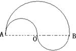

# Mathematics (Grade 6)

**ID**: cd8db972
**难度**: hard
**题型**: fill_in_the_blank

## 题目
如图，O为大半圆的圆心，AO=BO=5厘米，AO、BO分别是两个小半圆的直径，那么这个图形的周长是$\underline{\hspace{5em}}$厘米，面积是$\underline{\hspace{5em}}$平方厘米．

## 解答

**答案**: 31.4, 39.25

1. Step1:根据解析2可知，图形周长为大半圆的弧长加上2个小半圆的弧长，大半圆的直径为AB，AB = AO + BO = 5 + 5 = 10厘米，根据圆的周长公式C = πd（C为周长，d为直径），大半圆的弧长为3.14×10÷2 = 15.7厘米，小半圆的直径为5厘米，一个小半圆的弧长为3.14×5÷2，2个小半圆的弧长为3.14×5÷2×2 = 15.7厘米，所以图形周长为15.7 + 15.7 = 31.4厘米
2. Step2:根据解析2可知，图形面积等于大半圆的面积，大半圆半径为5厘米，根据圆的面积公式S = πr²（S为面积，r为半径），大半圆面积为3.14×5²÷2 = 3.14×25÷2 = 78.5÷2 = 39.25平方厘米

## 知识点

**知识点**:
  - 圆、圆环的周长；圆、圆环的面积．

---
