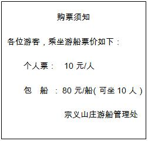

# Mathematics (Grade 6)

**ID**: cdae6678
**难度**: hard
**题型**: fill_in_the_blank

## 题目
青龙二小六（1）班46名同学在3名老师的带领下，来到宗义山庄乘船游玩，乘船处贴着一张购票须知，请根据以下须知，为他们设计至少两种购票方案，并找出一种最省钱的方案．
方案一：$\underline{\hspace{5em}}$      
方案二：$\underline{\hspace{5em}}$      
最便宜的购票方式是：$\underline{\hspace{5em}}$      ．

## 解答

**答案**: 全部买个人票, 包船5条, 买包船票

1. Step1:计算总人数，46名同学加上3名老师，即46 + 3 = 49人
2. Step2:设计方案一，全部买个人票，每人10元，总费用为49×10 = 490元
3. Step3:设计方案二，因为每条船可坐10人，49÷10 = 4（条）......9（人），所以包船5条，总费用为5×80 = 400元
4. Step4:比较两种方案费用，400＜490，得出最便宜的购票方式是包船5条，即买包船票

## 知识点

**知识点**:
  - 最优化问题

---
