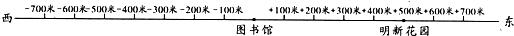

# Mathematics (Grade 6)

**ID**: ce0df9a7
**难度**: hard
**题型**: fill_in_the_blank

## 题目
如图每格表示100米，小华现在在图书馆处．

（1）如果小华从图书馆向东行400米，表示为+400米，那么从图书馆向西行200米，表示为$\underline{\hspace{5em}}$米．
（2）如果小华的位置是+200米，说明他是向$\underline{\hspace{5em}}$行了$\underline{\hspace{5em}}$米．
（3）如果小华在图书馆处先向西行300米，又向东行400米，这时小华的位置应表示为$\underline{\hspace{5em}}$米，这时小华离明新花园还有$\underline{\hspace{5em}}$米．

## 解答

**答案**: -200, 东, 200, +100, 400

1. Step1:根据向东行记为正，向西行记为负，小华从图书馆向西行200米，所以表示为-200米
2. Step2:因为向东行记为正，小华位置是+200米，所以是向东行了200米
3. Step3:小华先向西行300米又向东行400米，400 - 300 = 100米，实际向东行100米，位置表示为+100米
4. Step4:明新花园在图书馆东边500米处，小华位置是+100米，500 - 100 = 400米，所以离明新花园还有400米

## 知识点

**知识点**:
  - 负数的意义及其应用．

---
