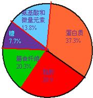

# Mathematics (Grade 6)

**ID**: ce306eb6
**难度**: hard
**题型**: fill_in_the_blank

## 题目
大豆营养丰富，其中蛋白质含量高，还含有脂肪、钙、磷、铁和维生素B1、维生素B2等人体需要的营养物质，都明显高于谷类和薯类食物，是一种理想的优质植物蛋白食物．
（1）大豆的主要成分是$\underline{\hspace{5em}}$、$\underline{\hspace{5em}}$、和$\underline{\hspace{5em}}$．
（2）吃100克大豆，可以补充多少克蛋白质？
（3）从图中能知道大豆含最高的是什么？假如糖的含量为7.7克，蛋白质的含量为多少？

## 解答

**答案**: 蛋白质, 脂肪, 膳食纤维, 37.3, 蛋白质, 37.3

1. Step1:观察题目所给信息及扇形统计图，根据各营养成分所占比例大小，得出大豆的主要成分是蛋白质、脂肪和膳食纤维
2. Step2:已知大豆中蛋白质含量为37.3%，计算吃100克大豆可补充的蛋白质含量，即100×37.3% = 37.3克
3. Step3:观察扇形统计图，得出大豆中含量最高的是蛋白质
4. Step4:已知糖的含量为7.7克，糖在大豆中所占比例为7.7%，先计算大豆的总重量为7.7÷7.7% = 100克，再根据蛋白质在大豆中所占比例37.3%，计算蛋白质含量为100×37.3% = 37.3克

## 知识点

**知识点**:
  - 统计图表的综合分析、解释和应用．

---
