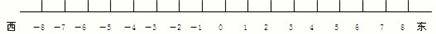

# Mathematics (Grade 6)

**ID**: ceaf9aa5
**难度**: hard
**题型**: fill_in_the_blank

## 题目
下面每一格表示1米，小华刚开始的位置在0处．

小华从0点向东走5米表示为+5米，那么他从0点向西走3米表示为$\underline{\hspace{5em}}$米；如果小华的位置是-8米，说明他向$\underline{\hspace{5em}}$走了$\underline{\hspace{5em}}$米；如果小华先向东走5米，再向西走8米，这时小华的位置表示为$\underline{\hspace{5em}}$米．

## 解答

**答案**: -3, 西, 8, -3

1. Step1:根据向东走记为正，向西走记为负，小华从0点向西走3米，所以表示为-3米
2. Step2:因为位置是-8米，负号表示向西，数值8表示距离，所以说明他向西走了8米
3. Step3:小华先向东走5米记为+5米，再向西走8米记为-8米，+5 + (-8)=-3米，所以这时小华的位置表示为-3米

## 知识点

**知识点**:
  - 负数的意义及其应用．

---
