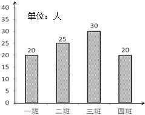

# Mathematics (Grade 6)

**ID**: d067fef3
**难度**: hard
**题型**: fill_in_the_blank

## 题目
如图是某小学六年级四个班男生人数统计图．
（1）这个统计图属 $\underline{\hspace{5em}}$ 统计图．
（2）三班男生人数比二班男生人数多 $\underline{\hspace{5em}}$ %．

## 解答

**答案**: 条形, 20

1. Step1:观察统计图的特征，根据条形统计图能很容易看出各种数量的多少这一特点，判断此统计图为条形统计图
2. Step2:先计算三班男生人数与二班男生人数的差值，即30 - 25 = 5人
3. Step3:用差值除以二班男生人数，即5÷25 = 0.2
4. Step4:将0.2转化为百分数，0.2×100% = 20%，得出三班男生人数比二班男生人数多20%

## 知识点

**知识点**:
  - 以一当五（或以上）的条形统计图;从统计图表中获取信息

---
