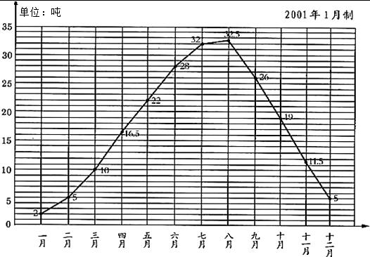

# Mathematics (Grade 6)

**ID**: d43f3a74
**难度**: hard
**题型**: fill_in_the_blank

## 题目
下面是某地冷饮厂2004年每月冷饮生产变化情况统计图

看图回答问题：
（1） $\underline{\hspace{5em}}$ 月份月份生产量最最低， $\underline{\hspace{5em}}$ 月份生产量最高．
（2）从1月份到8月份，生产量呈 $\underline{\hspace{5em}}$ 趋势，从8月份到12月份，生产量呈 $\underline{\hspace{5em}}$ 趋势．

## 解答

**答案**: 1, 8, 上升, 下降

1. Step1:观察统计图，找到生产数量对应的各月份，比较得出1月份对应的生产数量最低
2. Step2:继续观察统计图，比较得出8月份对应的生产数量最高
3. Step3:观察1 - 8月份生产数量的变化情况，发现数量逐渐增多，确定为上升趋势
4. Step4:观察8 - 12月份生产数量的变化情况，发现数量逐渐减少，确定为下降趋势

## 知识点

**知识点**:
  - 单式折线统计图

---
