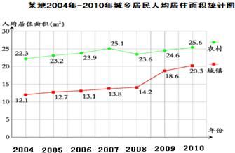

# Mathematics (Grade 6)

**ID**: d7e15ac4
**难度**: hard
**题型**: fill_in_the_blank

## 题目
如图是某地2004-2010年城乡居民人均居住面积统计图．

（1）农村人均居住面积最多的是$\underline{\hspace{5em}}$年，最少的是$\underline{\hspace{5em}}$年．
（2）2007年农村居住面积与城镇的相差$\underline{\hspace{5em}}$㎡．
（3）城镇居民人均居住面积增长得最快的是$\underline{\hspace{5em}}$年到$\underline{\hspace{5em}}$年．
（4）$\underline{\hspace{5em}}$年农村人均居住面积与城镇居住面积的差距最小．
（5）纵观该统计图，说明了$\underline{\hspace{5em}}$．

## 解答

**答案**: 2010, 2004, 11.3, 2008, 2009, 2010, 农村人均居住面积基本稳定，农村人均居住面积与城镇居住面积的差距逐渐缩小

1. Step1:观察统计图中农村人均居住面积对应的绿色折线，找到最高点对应的年份为2010年，最低点对应的年份为2004年，得出农村人均居住面积最多的是2010年，最少的是2004年
2. Step2:在统计图中找到2007年农村人均居住面积为25.1㎡，城镇人均居住面积为13.8㎡，计算差值25.1 - 13.8 = 11.3㎡
3. Step3:观察城镇居民人均居住面积对应的红色折线，比较各相邻年份间折线的倾斜程度，得出增长最快的是2008年到2009年
4. Step4:分别计算各年份农村与城镇人均居住面积的差值，比较得出2010年差距最小
5. Step5:整体观察统计图，分析农村和城镇人均居住面积的变化趋势，得出农村人均居住面积基本稳定，农村人均居住面积与城镇居住面积的差距逐渐缩小

## 知识点

**知识点**:
  - 复式折线统计图；从统计图表中获取信息．

---
