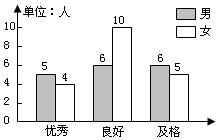

# Mathematics (Grade 6)

**ID**: dc2bf311
**难度**: hard
**题型**: fill_in_the_blank

## 题目
六年级一班的一次数学测验，具体统计如图．从图中可以看出：
①在这次测验中，优秀率是(     )%．
②男生的优秀人数比女生(     )（填“高”或“低”）(     )%．
③若4个“优秀”等第女生的分数分别为：99分，98分，91分，92分．你能用合适的方法求出这四个人的平均得分吗？

## 解答

**答案**: 25, 高, 2.8, 95

1. Step1:计算全班总人数，5 + 4 + 6 + 10 + 6 + 5 = 36人
2. Step2:计算优秀人数，5 + 4 = 9人
3. Step3:计算优秀率，9÷36 = 0.25 = 25%
4. Step4:计算男生优秀率，5÷36≈0.139 = 13.9%
5. Step5:计算女生优秀率，4÷36≈0.111 = 11.1%
6. Step6:比较男生和女生优秀率，13.9% - 11.1% = 2.8%，得出男生优秀率比女生高2.8%
7. Step7:计算四个女生的总分数，99 + 98 + 91 + 92 = 380分
8. Step8:计算四个女生的平均得分，380÷4 = 95分

## 知识点

**知识点**:
  - 从统计图表中获取信息;以一当二的条形统计图

---
