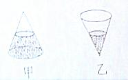

# Mathematics (Grade 6)

**ID**: dc491852
**难度**: hard
**题型**: fill_in_the_blank

## 题目
如图，两个相同的圆锥容器中各盛一些水，水深都是圆锥高的一半，那么，甲容器中的水的体积是乙容器中水的$\underline{\hspace{5em}}$倍．（提示：设圆锥底面半径为R，则甲容器中水面半径为$\frac{1}{2}$R，设圆锥高为h）

## 解答

**答案**: 7

1. Step1:设圆锥的底面半径为2r，高为2h
2. Step2:计算甲圆锥内水的体积，根据圆锥体积公式V = $rac{1}{3}$πR²H，甲圆锥内水的体积等于大圆锥体积减去上面空的小圆锥体积，即$rac{1}{3}$π（2r）²×2h - $rac{1}{3}$πr²h = $rac{8}{3}$πr²h - $rac{1}{3}$πr²h = $rac{7}{3}$πr²h
3. Step3:计算乙圆锥内水的体积，根据圆锥体积公式可得乙圆锥内水的体积为$rac{1}{3}$πr²h
4. Step4:计算甲容器内水的体积是乙容器内水的体积的倍数，即$rac{7}{3}$πr²h÷$rac{1}{3}$πr²h = 7

## 知识点

**知识点**:
  - 关于圆锥的应用题．

---
