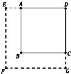

# Mathematics (Grade 6)

**ID**: de50b5e9
**难度**: hard
**题型**: fill_in_the_blank

## 题目
如图，一个正方形的边长增加它的$\frac{1}{3}$后，得到的新正方形的面积与原正方形的面积之比为$\underline{\hspace{5em}}$．

## 解答

**答案**: 16:9

1. Step1:设原来正方形的边长为1
2. Step2:计算新正方形的边长，为1 + 1×(1/3) = 4/3
3. Step3:根据正方形面积公式，原正方形面积为1×1 = 1
4. Step4:新正方形面积为(4/3)×(4/3) = 16/9
5. Step5:求新正方形面积与原正方形面积之比，即(16/9) : 1 = 16 : 9

## 知识点

**知识点**:
  - 比的意义．

---
